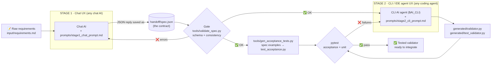

# Multi-Stage AI Workflow: Chat → CLI Agent
### From plain-English requirements to tested validation code

**Author:** Aklile Mamo · **UX types chained:** Chat AI → CLI coding agent (an IDE agent works too)

---

## 1. The problem

Turning a product owner's informal requirements ("age must be 16–120, VIP can't use promo
codes…") into validation code is slow and error-prone. A developer has to interpret the
text, write the code, think up test cases, and write the tests by hand.

The task splits into two stages, and each stage suits a different AI UX:

| Stage | Needs | Best UX |
|---|---|---|
| 1. Understand and structure the requirements | Conversation, clarification, reasoning over prose | **Chat** |
| 2. Write code and tests in a project, then run them | File system access, running commands, iterating on failures | **CLI agent** |

## 2. Workflow diagram



*(Editable source: `docs/workflow-diagram.mmd`, in Mermaid.)*

The **handoff contract** between the two UX types is `handoff/spec.json`, a JSON file that
must conform to `schema/spec.schema.json`. Neither tool knows anything about the other; they
only share this file format.

## 3. Step-by-step

| # | Who / UX | Input | Action | Output |
|---|---|---|---|---|
| 1 | Human | Organiser's notes | Save the notes as `input/requirements.md` | Raw requirements |
| 2 | **Chat AI** (any) | `prompts/stage1_chat_prompt.md` + requirements | Paste both into the chat. The AI returns a strict JSON spec with fields, rules, error codes and **worked examples** | `handoff/spec.json` |
| 3 | Script (gate) | `spec.json` | `tools/validate_spec.py` checks the schema, unique codes, that examples only use known codes, that every code is tested, and that a valid example exists | Pass, or a list of errors to paste back into the chat (loop back to step 2) |
| 4 | Script | `spec.json` | `tools/gen_acceptance_tests.py` turns the spec's examples into `generated/test_acceptance.py` | Independent acceptance tests |
| 5 | **CLI AI agent** (any) | `prompts/stage2_cli_prompt.md` + `spec.json` | The agent reads the spec, writes `validator.py` and its own edge-case tests, runs pytest and fixes its own failures | `generated/validator.py`, `generated/test_validator.py` |
| 6 | Script | Generated code | `pytest` runs the acceptance tests (from Stage 1) and the unit tests (from Stage 2) | Pass/fail report in `logs/` |

**Why step 4 matters:** the acceptance tests come from the *chat* stage, so the *coding* agent
can't pass by writing weak tests of its own. The two AIs effectively check each other.

## 4. How to run it

```bash
pip install pytest jsonschema

# Replay mode: tests the committed Stage 1 and Stage 2 outputs (no API keys needed)
./run_pipeline.sh

# Live mode: plug in ANY CLI agent for Stage 2
AI_CLI='claude -p --permission-mode acceptEdits' ./run_pipeline.sh   # Claude Code
AI_CLI='gemini -y -p'                               ./run_pipeline.sh   # Gemini CLI
AI_CLI='codex exec --full-auto'                     ./run_pipeline.sh   # Codex CLI
AI_CLI='aider --yes --message'                      ./run_pipeline.sh   # aider (any model)
```

Using an IDE instead of a CLI: open the folder in VS Code (Copilot agent mode) or Cursor,
paste `prompts/stage2_cli_prompt.md` into the agent chat, then run `./run_pipeline.sh`.

Try the result yourself:
```bash
echo '{"full_name":"A","email":"bad","age":10,"ticket_type":"student"}' | python3 generated/validator.py
```

## 5. Test evidence (end-to-end run)

```
== [1/4] Gate: validating Stage 1 (chat) output: handoff/spec.json
SPEC OK: 6 fields, 2 cross-field rules, 27 examples
== [2/4] Generating independent acceptance tests from the spec
Wrote generated/test_acceptance.py with 27 acceptance tests
== [3/4] Stage 2 ...
== [4/4] Running acceptance + unit tests
44 passed in 0.03s
== Demo: validating a sample registration
promo_code.not_allowed_for_vip: VIP tickets cannot use a promo code.
== PIPELINE PASSED.
```

When the gate catches a broken chat output (`logs/gate_rejection_example.log`):
```
SPEC REJECTED. Paste these back into the chat AI to fix:
  - Example 'valid standard' uses unknown codes ['email.bogus']
  - Codes never exercised by an example: ['promo_code.not_allowed_for_vip']
```

## 6. Adaptability (tool-agnostic design)

- **Contract, not integration:** the stages share only a JSON file and a JSON Schema. There
  are no vendor SDKs or API calls in the pipeline code.
- **Prompts are plain Markdown files** in `prompts/` that work in any chat or agent.
- **Stage 2 is a single environment variable** (`AI_CLI`), so you can switch providers
  without editing code.
- **Plain Python, standard library only, for the deliverable**: no framework lock-in.
- **Reusable for other problems:** replace `requirements.md` and the same pipeline produces a
  validator for a different form, such as a loan application or student enrolment.

## 7. Efficiency: manual effort saved

| Task | Manual | With this workflow |
|---|---|---|
| Interpret requirements into precise rules | ~20 min | Chat AI, ~1 min |
| Write 27 test cases | ~30 min | Generated from the spec automatically |
| Write the validator | ~30 min | CLI agent, ~2 min |
| Check that the code matches the requirements | Manual review | Automated gate + 44 tests |
| **Total** | **~1.5 hours** | **~5 minutes plus a quick human review** |

The human only writes requirements and reviews the result. Every handoff between steps is
automated or checked automatically.

## 8. Project structure

```
ai-workflow/
├── README.md                    ← this document
├── run_pipeline.sh              ← end-to-end runner
├── input/requirements.md        ← raw human input
├── prompts/
│   ├── stage1_chat_prompt.md    ← Chat UX prompt
│   └── stage2_cli_prompt.md     ← CLI/IDE agent prompt
├── schema/spec.schema.json      ← handoff contract
├── handoff/spec.json            ← Stage 1 output = Stage 2 input
├── tools/
│   ├── validate_spec.py         ← quality gate
│   └── gen_acceptance_tests.py  ← spec examples → tests
├── generated/                   ← Stage 2 output + tests
├── docs/workflow-diagram.(mmd|png)
└── logs/                        ← run evidence
```

## 9. Limitations and next steps

- Stage 1 is still a copy-paste step. It could be automated with any chat model's API, at the
  cost of making the pipeline less tool-agnostic.
- The spec format covers string and integer fields. Adding `date`, `number` and `array` would
  widen its use.
- A third stage, such as an IDE agent wiring the validator into a web form, would extend the
  chain further.
